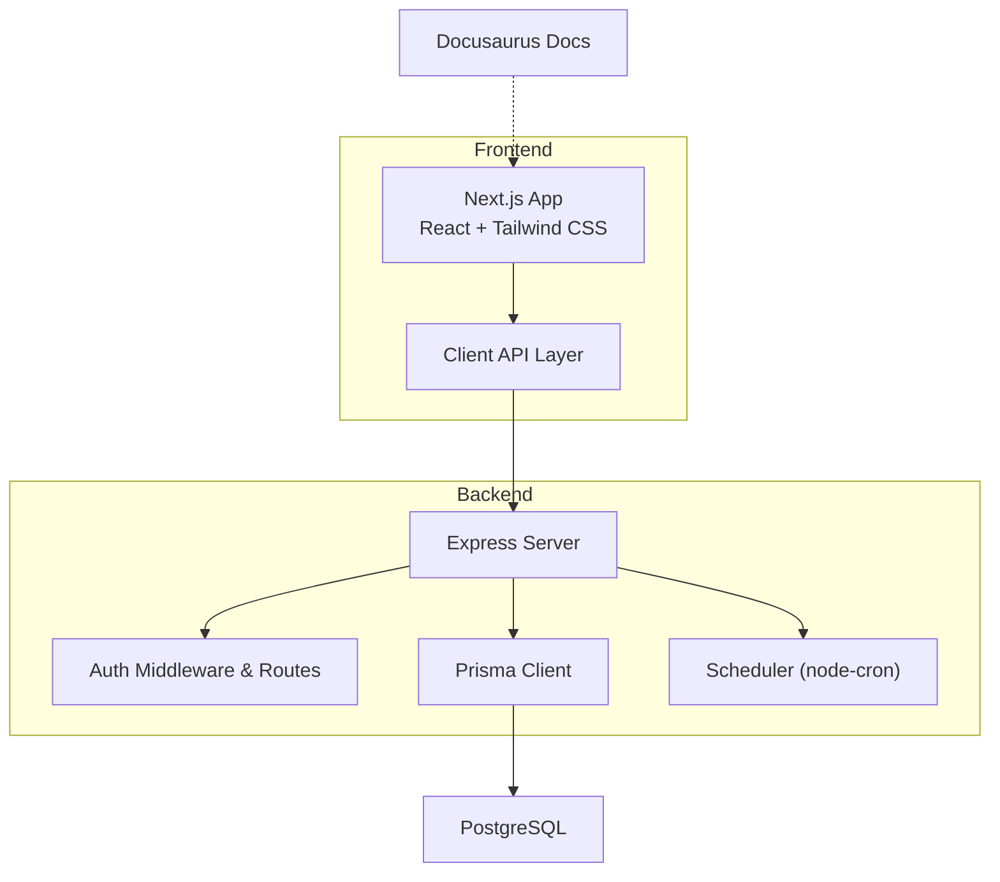
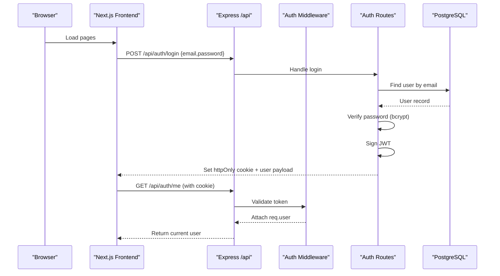
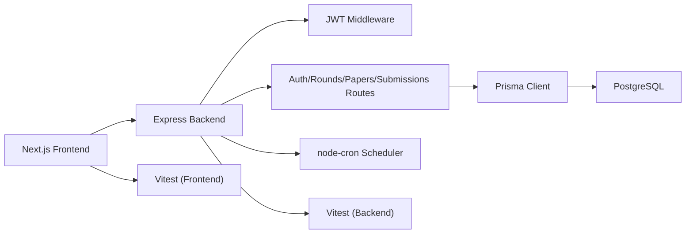
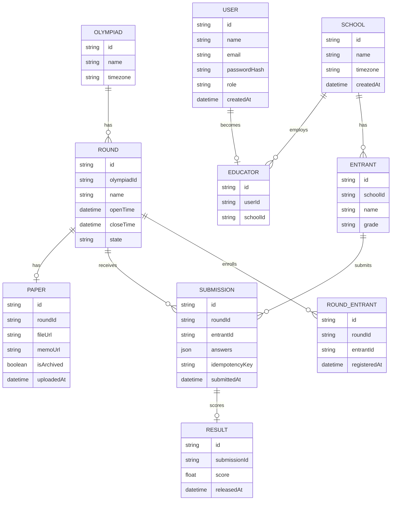

# Technology Stack

<cite>
**Referenced Files in This Document**
- [frontend/package.json](file://frontend/package.json)
- [backend/package.json](file://backend/package.json)
- [documents/docusaurus.config.js](file://documents/docusaurus.config.js)
- [shared/types.js](file://shared/types.js)
- [backend/prisma/schema.prisma](file://backend/prisma/schema.prisma)
- [frontend/next.config.mjs](file://frontend/next.config.mjs)
- [backend/src/index.js](file://backend/src/index.js)
- [frontend/src/lib/api.js](file://frontend/src/lib/api.js)
- [backend/src/middleware/auth.js](file://backend/src/middleware/auth.js)
- [backend/src/routes/auth.js](file://backend/src/routes/auth.js)
- [backend/vitest.config.mjs](file://backend/vitest.config.mjs)
- [frontend/vitest.config.mjs](file://frontend/vitest.config.mjs)
- [backend/eslint.config.mjs](file://backend/eslint.config.mjs)
- [frontend/eslint.config.mjs](file://frontend/eslint.config.mjs)
- [documents/docs/tech-stack.md](file://documents/docs/tech-stack.md)
</cite>

## Table of Contents
1. Introduction
2. Project Structure
3. Core Components
4. Architecture Overview
5. Detailed Component Analysis
6. Dependency Analysis
7. Performance Considerations
8. Troubleshooting Guide
9. Conclusion
10. Appendices

## Introduction
This document describes the complete technology stack for the Olympiad Portal, including frontend, backend, database, ORM, authentication, styling, testing, code quality, and documentation tools. It explains each major dependency’s role, version compatibility, integration patterns, architectural decisions and trade-offs, and provides migration paths and upgrade considerations.

## Project Structure
The repository is organized into distinct layers:
- Frontend (Next.js app): UI, routing, client API client, tests, linting, and build configuration.
- Backend (Express server): REST API routes, middleware, Prisma client, scheduler, tests, and linting.
- Shared types: JSDoc-based type definitions used across frontend and backend to keep contracts consistent.
- Documentation site: Docusaurus project with Mermaid support and theme configuration.
- Database schema and migrations: Prisma schema and PostgreSQL migrations.

**Diagram sources**
- [frontend/package.json:15-33](file://frontend/package.json#L15-L33)
- [backend/package.json:19-43](file://backend/package.json#L19-L43)
- [backend/src/index.js:1-43](file://backend/src/index.js#L1-L43)
- [backend/src/middleware/auth.js:1-35](file://backend/src/middleware/auth.js#L1-L35)
- [backend/src/routes/auth.js:1-152](file://backend/src/routes/auth.js#L1-L152)
- [backend/prisma/schema.prisma:1-109](file://backend/prisma/schema.prisma#L1-L109)
- [documents/docusaurus.config.js:1-136](file://documents/docusaurus.config.js#L1-L136)

**Section sources**
- [frontend/package.json:1-36](file://frontend/package.json#L1-L36)
- [backend/package.json:1-50](file://backend/package.json#L1-L50)
- [documents/docusaurus.config.js:1-136](file://documents/docusaurus.config.js#L1-L136)

## Core Components
- Frontend framework: Next.js 16.3.0 with React 19.x and Tailwind CSS v4 via PostCSS plugin.
- Backend framework: Express 5.2.1 with CORS, cookie parsing, JSON body parsing, and static file serving.
- Database: PostgreSQL configured via Prisma datasource.
- ORM: Prisma Client 5.22.x with schema-first modeling and migrations.
- Authentication: bcrypt for password hashing; JWT for stateless sessions stored in httpOnly cookies; Passport present but not required by current flows.
- Scheduler: node-cron for round lifecycle transitions.
- Testing: Vitest for both frontend and backend with V8 coverage and jsdom environment for browser-like tests.
- Code quality: ESLint with recommended configs and Prettier integration; Next-specific rules on the frontend.
- Documentation: Docusaurus with Mermaid enabled and classic preset.

Key roles and integration points:
- The frontend uses a shared API client that calls the backend under /api, sending credentials via cookies.
- The backend mounts routers under /api and enforces authentication via middleware using JWT from cookies.
- Prisma connects to PostgreSQL using DATABASE_URL and generates a typed client used by routes and services.
- Tests are co-located with source files and executed via Vitest scripts defined in package.json.

**Section sources**
- [frontend/package.json:15-33](file://frontend/package.json#L15-L33)
- [backend/package.json:19-43](file://backend/package.json#L19-L43)
- [backend/src/index.js:16-32](file://backend/src/index.js#L16-L32)
- [backend/src/middleware/auth.js:1-35](file://backend/src/middleware/auth.js#L1-L35)
- [backend/src/routes/auth.js:1-152](file://backend/src/routes/auth.js#L1-L152)
- [backend/prisma/schema.prisma:1-109](file://backend/prisma/schema.prisma#L1-L109)
- [frontend/src/lib/api.js:1-146](file://frontend/src/lib/api.js#L1-L146)
- [backend/vitest.config.mjs:1-28](file://backend/vitest.config.mjs#L1-L28)
- [frontend/vitest.config.mjs:1-31](file://frontend/vitest.config.mjs#L1-L31)
- [backend/eslint.config.mjs:1-18](file://backend/eslint.config.mjs#L1-L18)
- [frontend/eslint.config.mjs:1-17](file://frontend/eslint.config.mjs#L1-L17)
- [documents/docusaurus.config.js:17-70](file://documents/docusaurus.config.js#L17-L70)

## Architecture Overview
The system follows a clear separation of concerns:
- Next.js serves the UI and performs SSR where needed.
- Express exposes a REST API under /api.
- Prisma abstracts database access and ensures schema consistency.
- JWT-based auth protects endpoints via middleware.
- A background scheduler updates round states based on time windows.

**Diagram sources**
- [frontend/src/lib/api.js:114-139](file://frontend/src/lib/api.js#L114-L139)
- [backend/src/routes/auth.js:22-97](file://backend/src/routes/auth.js#L22-L97)
- [backend/src/middleware/auth.js:5-20](file://backend/src/middleware/auth.js#L5-L20)
- [backend/src/index.js:16-32](file://backend/src/index.js#L16-L32)

## Detailed Component Analysis

### Frontend: Next.js 16.3.0
- Role: UI framework providing routing, SSR, and build tooling.
- Dependencies: React 19.2.8, Tailwind CSS v4 via @tailwindcss/postcss, Vitest for unit tests, ESLint with next config and Prettier.
- Integration: Uses a centralized API client to call backend endpoints with credentials included.
- Configuration: Minimal Next config; PostCSS and Tailwind integrated via standard setup.

Upgrade and migration notes:
- Keep React aligned with Next.js supported versions; verify peer dependencies when upgrading Next.
- Tailwind v4 requires the PostCSS plugin; ensure post-processing pipeline remains compatible.
- Vitest v4 is used; maintain test environment and alias configuration when updating.

**Section sources**
- [frontend/package.json:15-33](file://frontend/package.json#L15-L33)
- [frontend/next.config.mjs:1-7](file://frontend/next.config.mjs#L1-L7)
- [frontend/src/lib/api.js:1-146](file://frontend/src/lib/api.js#L1-L146)
- [frontend/vitest.config.mjs:1-31](file://frontend/vitest.config.mjs#L1-L31)
- [frontend/eslint.config.mjs:1-17](file://frontend/eslint.config.mjs#L1-L17)

### Backend: Express 5.2.1
- Role: HTTP server exposing REST APIs for rounds, papers, submissions, and authentication.
- Dependencies: Express 5.2.1, CORS, cookie-parser, JSON parsing, multer for uploads, node-cron for scheduling, bcrypt and JWT for auth, Prisma client for DB access.
- Integration: Mounts routers under /api, serves static uploads, starts scheduler on boot.

Upgrade and migration notes:
- Express 5.x introduces changes; review breaking changes before major upgrades.
- Ensure middleware order remains correct (CORS and cookie-parser before routers).
- When upgrading Prisma, regenerate client and validate migrations.

**Section sources**
- [backend/package.json:19-43](file://backend/package.json#L19-L43)
- [backend/src/index.js:1-43](file://backend/src/index.js#L1-L43)

### Database: PostgreSQL with Prisma
- Role: Relational data store for Olympiads, Rounds, Users, Schools, Entrants, Papers, Submissions, Results, and RoundEntrants.
- Schema: Single source of truth via Prisma schema; migrations managed through Prisma CLI.
- Integration: Backend uses generated Prisma client for type-safe queries.

Upgrade and migration notes:
- Use Prisma migrations to evolve schema safely; back up before applying.
- Align Prisma client version with Prisma CLI for compatibility.
- Review driver adapter or provider changes if switching databases.

**Section sources**
- [backend/prisma/schema.prisma:1-109](file://backend/prisma/schema.prisma#L1-L109)

### Authentication: bcrypt + JWT
- Role: Secure password hashing and stateless session management via signed tokens in httpOnly cookies.
- Flow: Login registers or verifies user, signs JWT, sets cookie; protected routes decode and validate token via middleware.
- Integration: Frontend includes credentials with requests; middleware attaches decoded user to request context.

Upgrade and migration notes:
- Rotate JWT secrets securely during deployments.
- Consider adding refresh tokens or short-lived access tokens for enhanced security.
- Validate cookie flags (secure, sameSite) per deployment environment.

**Section sources**
- [backend/src/routes/auth.js:1-152](file://backend/src/routes/auth.js#L1-L152)
- [backend/src/middleware/auth.js:1-35](file://backend/src/middleware/auth.js#L1-L35)

### Scheduler: node-cron
- Role: Periodically evaluates round open/close times and updates round state accordingly.
- Integration: Started on server boot; runs in-process without external job queues.

Upgrade and migration notes:
- For high scale, consider moving to a distributed queue (e.g., BullMQ, Redis-backed) to avoid single-node limitations.
- Ensure timezone handling is consistent (UTC comparisons) and documented.

**Section sources**
- [backend/package.json:27-31](file://backend/package.json#L27-L31)
- [backend/src/index.js:34-40](file://backend/src/index.js#L34-L40)

### Styling: Tailwind CSS v4
- Role: Utility-first CSS framework for rapid UI development.
- Integration: Configured via PostCSS plugin in the frontend; no custom classes beyond utilities.

Upgrade and migration notes:
- Tailwind v4 changes configuration model; rely on PostCSS plugin and default conventions.
- Keep PostCSS pipeline updated alongside Tailwind.

**Section sources**
- [frontend/package.json:21-33](file://frontend/package.json#L21-L33)

### Testing: Vitest
- Role: Fast unit and integration testing for both frontend and backend with V8 coverage.
- Configuration: Node environment for backend; jsdom for frontend; thresholds enforced.

Upgrade and migration notes:
- Maintain test isolation and mock strategies when upgrading Vitest.
- Update coverage reporters and thresholds as codebase evolves.

**Section sources**
- [backend/vitest.config.mjs:1-28](file://backend/vitest.config.mjs#L1-L28)
- [frontend/vitest.config.mjs:1-31](file://frontend/vitest.config.mjs#L1-L31)

### Code Quality: ESLint + Prettier
- Role: Enforce coding standards and formatting across projects.
- Configuration: Backend uses recommended JS rules with globals; frontend uses Next vitals config and ignores build artifacts.

Upgrade and migration notes:
- Pin rule sets and align with team standards; update configs when adopting new language features.
- Integrate with pre-commit hooks to enforce checks early.

**Section sources**
- [backend/eslint.config.mjs:1-18](file://backend/eslint.config.mjs#L1-L18)
- [frontend/eslint.config.mjs:1-17](file://frontend/eslint.config.mjs#L1-L17)

### Documentation: Docusaurus
- Role: Static site generator for docs and blog with Mermaid diagrams enabled.
- Configuration: Classic preset, custom CSS, navbar/footer links, and theme settings.

Upgrade and migration notes:
- Enable future flags for upcoming versions; monitor deprecations.
- Keep plugins and themes updated for security and performance.

**Section sources**
- [documents/docusaurus.config.js:1-136](file://documents/docusaurus.config.js#L1-L136)

## Dependency Analysis
High-level relationships between core components:

**Diagram sources**
- [frontend/package.json:15-33](file://frontend/package.json#L15-L33)
- [backend/package.json:19-43](file://backend/package.json#L19-L43)
- [backend/src/index.js:1-43](file://backend/src/index.js#L1-L43)
- [backend/src/middleware/auth.js:1-35](file://backend/src/middleware/auth.js#L1-L35)
- [backend/src/routes/auth.js:1-152](file://backend/src/routes/auth.js#L1-L152)
- [backend/prisma/schema.prisma:1-109](file://backend/prisma/schema.prisma#L1-L109)

**Section sources**
- [frontend/package.json:15-33](file://frontend/package.json#L15-L33)
- [backend/package.json:19-43](file://backend/package.json#L19-L43)
- [backend/src/index.js:1-43](file://backend/src/index.js#L1-L43)

## Performance Considerations
- Concurrency: Express handles concurrent requests efficiently; use connection pooling for PostgreSQL and consider caching hot reads.
- File uploads: Multer streams large files; offload storage to object storage (e.g., S3-compatible) to reduce DB pressure.
- Scheduler: node-cron runs in-process; for multi-instance deployments, distribute jobs or use a queue.
- Frontend rendering: Leverage Next.js SSR selectively to minimize unnecessary re-renders; cache API responses where appropriate.

[No sources needed since this section provides general guidance]

## Troubleshooting Guide
Common issues and resolutions:
- Authentication failures:
  - Missing or invalid JWT cookie leads to 401; verify cookie presence and secret alignment.
  - Expired tokens require re-login; ensure token lifetime matches expectations.
- CORS errors:
  - Ensure frontend origin is allowed and credentials are enabled in CORS settings.
- Database connectivity:
  - Validate DATABASE_URL and network access; confirm migrations applied.
- Upload failures:
  - Check multer configuration and storage permissions; verify content-type headers.

**Section sources**
- [backend/src/middleware/auth.js:5-20](file://backend/src/middleware/auth.js#L5-L20)
- [backend/src/index.js:16-24](file://backend/src/index.js#L16-L24)
- [backend/prisma/schema.prisma:6-9](file://backend/prisma/schema.prisma#L6-L9)

## Conclusion
The Olympiad Portal adopts a modern, well-separated stack: Next.js for the UI, Express for the API, PostgreSQL with Prisma for data, and JWT for secure, stateless authentication. Supporting tools like Tailwind CSS, Vitest, ESLint, and Docusaurus enhance productivity, quality, and documentation. The architecture balances simplicity and scalability, with clear upgrade paths and migration strategies for each component.

[No sources needed since this section summarizes without analyzing specific files]

## Appendices

### Version Compatibility Matrix
- Frontend: Next.js 16.3.0 with React 19.2.8; Tailwind CSS v4 via PostCSS plugin; Vitest v4; ESLint with Next config.
- Backend: Express 5.2.1; Prisma Client 5.22.x; bcrypt 6.x; JWT 9.x; node-cron 4.x; Vitest v4; ESLint with recommended rules.
- Docs: Docusaurus with classic preset and Mermaid theme.

**Section sources**
- [frontend/package.json:15-33](file://frontend/package.json#L15-L33)
- [backend/package.json:19-43](file://backend/package.json#L19-L43)
- [documents/docusaurus.config.js:41-70](file://documents/docusaurus.config.js#L41-L70)

### Migration Paths and Upgrade Considerations
- Next.js: Align React version; review breaking changes in major releases; update PostCSS/Tailwind pipeline as needed.
- Express: Evaluate v5+ changes; ensure middleware ordering; update route handlers if APIs change.
- Prisma: Regenerate client after schema changes; apply migrations incrementally; test thoroughly before production rollout.
- JWT/bcrypt: Rotate secrets periodically; consider adding refresh tokens; validate cookie security flags per environment.
- Vitest: Keep environments and aliases consistent; adjust coverage thresholds as code grows.
- Docusaurus: Monitor future flags and plugin deprecations; update themes and presets as advised.

**Section sources**
- [frontend/package.json:15-33](file://frontend/package.json#L15-L33)
- [backend/package.json:19-43](file://backend/package.json#L19-L43)
- [backend/prisma/schema.prisma:1-109](file://backend/prisma/schema.prisma#L1-L109)
- [backend/src/routes/auth.js:13-20](file://backend/src/routes/auth.js#L13-L20)
- [backend/src/middleware/auth.js:5-20](file://backend/src/middleware/auth.js#L5-L20)
- [documents/docusaurus.config.js:21-24](file://documents/docusaurus.config.js#L21-L24)

### Data Model Reference
Shared types define key entities used across the application to maintain contract consistency.

**Diagram sources**
- [shared/types.js:1-38](file://shared/types.js#L1-L38)
- [backend/prisma/schema.prisma:11-109](file://backend/prisma/schema.prisma#L11-L109)