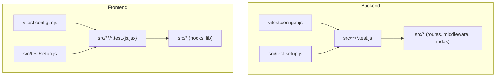
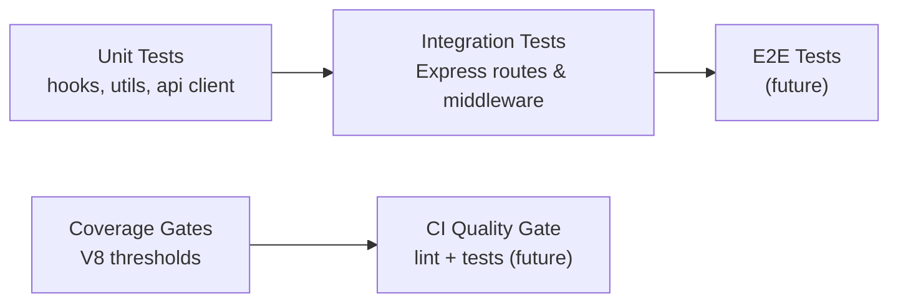
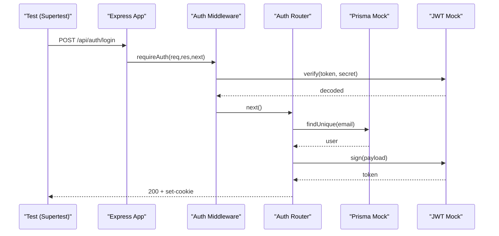
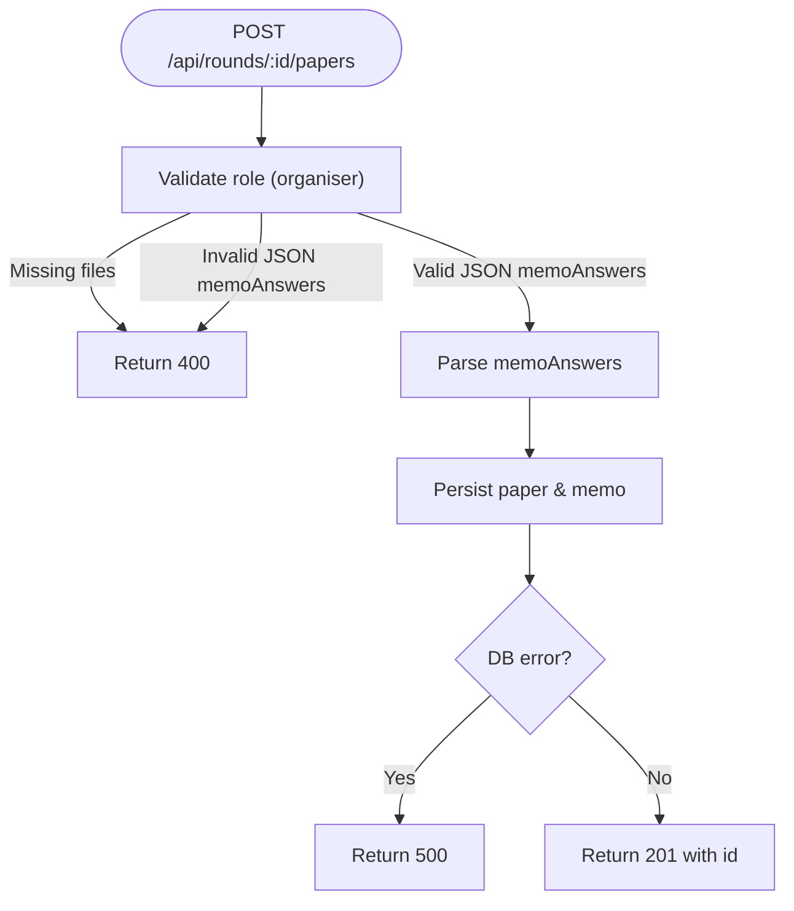
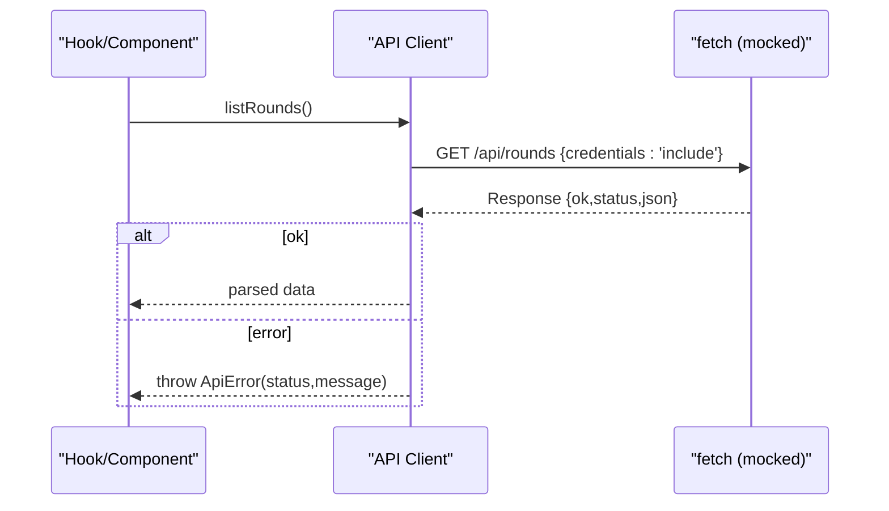
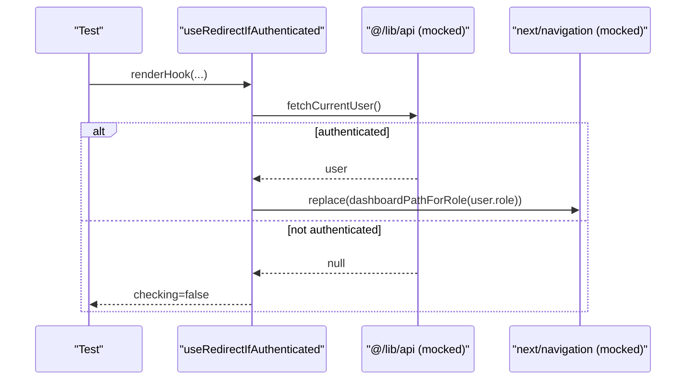
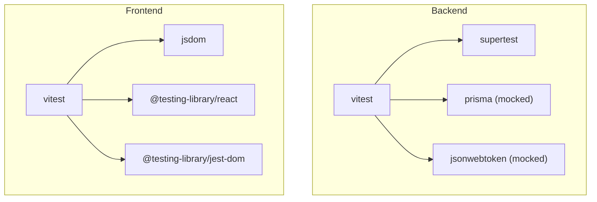
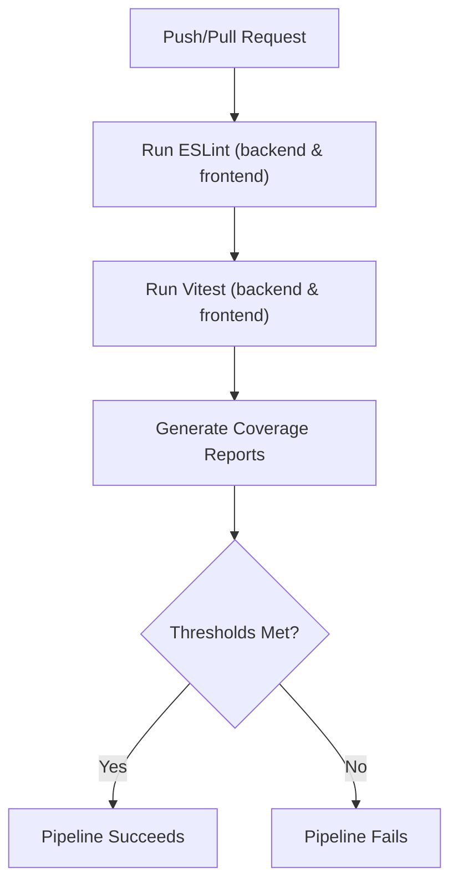

# Testing Strategy

<cite>
**Referenced Files in This Document**
- [backend/vitest.config.mjs](file://backend/vitest.config.mjs)
- [frontend/vitest.config.mjs](file://frontend/vitest.config.mjs)
- [backend/src/test-setup.js](file://backend/src/test-setup.js)
- [frontend/src/test/setup.js](file://frontend/src/test/setup.js)
- [backend/package.json](file://backend/package.json)
- [frontend/package.json](file://frontend/package.json)
- [backend/src/index.test.js](file://backend/src/index.test.js)
- [backend/src/middleware/auth.test.js](file://backend/src/middleware/auth.test.js)
- [backend/src/routes/auth.test.js](file://backend/src/routes/auth.test.js)
- [backend/src/routes/papers.test.js](file://backend/src/routes/papers.test.js)
- [frontend/src/hooks/useAuthRedirect.test.js](file://frontend/src/hooks/useAuthRedirect.test.js)
- [frontend/src/hooks/useRequireRole.test.js](file://frontend/src/hooks/useRequireRole.test.js)
- [frontend/src/lib/api.test.js](file://frontend/src/lib/api.test.js)
- [.gitea/workflows/lint.yml](file://.gitea/workflows/lint.yml)
</cite>

## Table of Contents
1. Introduction
2. Project Structure
3. Core Components
4. Architecture Overview
5. Detailed Component Analysis
6. Dependency Analysis
7. Performance Considerations
8. Troubleshooting Guide
9. Conclusion

## Introduction
This document defines the testing strategy for the Olympiad Portal, covering both backend and frontend. It explains how Vitest is configured and used across layers, outlines a testing pyramid (unit, integration, end-to-end), and provides guidance on test organization, naming conventions, mocking strategies, coverage thresholds, continuous integration, and quality gates. It also includes examples grounded in existing tests for authentication flows, API endpoints, and React hooks/components.

## Project Structure
The project uses a monorepo-style layout with separate backend and frontend packages, each with its own Vitest configuration and test suites:
- Backend: Node/Express routes and middleware tested with Vitest in a Node environment using Supertest for HTTP assertions and mocked Prisma/JWT dependencies.
- Frontend: Next.js app with React hooks and an API client tested with Vitest in a jsdom environment, using @testing-library/react and mocked fetch.

**Diagram sources**
- [backend/vitest.config.mjs:1-27](file://backend/vitest.config.mjs#L1-L27)
- [frontend/vitest.config.mjs:1-30](file://frontend/vitest.config.mjs#L1-L30)
- [backend/src/test-setup.js:1-5](file://backend/src/test-setup.js#L1-L5)
- [frontend/src/test/setup.js:1-2](file://frontend/src/test/setup.js#L1-L2)

**Section sources**
- [backend/vitest.config.mjs:1-27](file://backend/vitest.config.mjs#L1-L27)
- [frontend/vitest.config.mjs:1-30](file://frontend/vitest.config.mjs#L1-L30)
- [backend/src/test-setup.js:1-5](file://backend/src/test-setup.js#L1-L5)
- [frontend/src/test/setup.js:1-2](file://frontend/src/test/setup.js#L1-L2)

## Core Components
- Test runner and environment
  - Backend: Vitest in Node environment; global test APIs enabled; setup file sets environment variables.
  - Frontend: Vitest in jsdom environment; globals enabled; setup imports testing library DOM matchers.
- Coverage
  - Both sides use V8 provider with text, HTML, and lcov reporters.
  - Thresholds are enforced at lines/functions/branches/statements to maintain quality.
- Scripts
  - Backend and frontend expose npm scripts for running tests, coverage, and watch mode.

Key responsibilities:
- Backend tests validate Express routes, middleware behavior, and error handling via HTTP-level assertions.
- Frontend tests validate hook logic, API client behavior, and user interactions through renderHook and mocked fetch.

**Section sources**
- [backend/vitest.config.mjs:1-27](file://backend/vitest.config.mjs#L1-L27)
- [frontend/vitest.config.mjs:1-30](file://frontend/vitest.config.mjs#L1-L30)
- [backend/package.json:6-13](file://backend/package.json#L6-L13)
- [frontend/package.json:5-13](file://frontend/package.json#L5-L13)

## Architecture Overview
The testing architecture follows a layered approach:
- Unit tests: Validate pure functions, hooks, and small utilities in isolation.
- Integration tests: Validate route handlers and middleware by mounting Express apps and asserting HTTP responses.
- End-to-end tests: Not present in this repository; can be added later using Playwright or Cypress against a running server and UI.

[No sources needed since this diagram shows conceptual workflow, not actual code structure]

## Detailed Component Analysis

### Backend Authentication Flow Tests
The backend tests cover authentication routes and middleware:
- Route-level tests mount an Express app with cookie parsing and route registration, then assert status codes, headers, and side effects.
- Middleware tests verify JWT verification, role checks, and error responses.

**Diagram sources**
- [backend/src/routes/auth.test.js:1-287](file://backend/src/routes/auth.test.js#L1-L287)
- [backend/src/middleware/auth.test.js:1-110](file://backend/src/middleware/auth.test.js#L1-L110)

**Section sources**
- [backend/src/routes/auth.test.js:1-287](file://backend/src/routes/auth.test.js#L1-L287)
- [backend/src/middleware/auth.test.js:1-110](file://backend/src/middleware/auth.test.js#L1-L110)

### Backend Papers Upload and Retrieval Tests
Tests validate authorization, input validation, file handling, and database interactions for paper uploads and retrieval.

**Diagram sources**
- [backend/src/routes/papers.test.js:1-209](file://backend/src/routes/papers.test.js#L1-L209)

**Section sources**
- [backend/src/routes/papers.test.js:1-209](file://backend/src/routes/papers.test.js#L1-L209)

### Frontend API Client Tests
The frontend API client tests mock fetch to validate request construction, error handling, and response mapping. They ensure credentials are included where required and that errors are wrapped into a consistent ApiError type.

**Diagram sources**
- [frontend/src/lib/api.test.js:1-337](file://frontend/src/lib/api.test.js#L1-L337)

**Section sources**
- [frontend/src/lib/api.test.js:1-337](file://frontend/src/lib/api.test.js#L1-L337)

### Frontend Hook Tests (Authentication Redirect and Role Requirements)
Hooks are tested using renderHook to simulate async state and navigation behavior. Tests verify redirects based on authentication state and role checks.

**Diagram sources**
- [frontend/src/hooks/useAuthRedirect.test.js:1-66](file://frontend/src/hooks/useAuthRedirect.test.js#L1-L66)
- [frontend/src/hooks/useRequireRole.test.js:1-87](file://frontend/src/hooks/useRequireRole.test.js#L1-L87)

**Section sources**
- [frontend/src/hooks/useAuthRedirect.test.js:1-66](file://frontend/src/hooks/useAuthRedirect.test.js#L1-L66)
- [frontend/src/hooks/useRequireRole.test.js:1-87](file://frontend/src/hooks/useRequireRole.test.js#L1-L87)

### Backend Root App Tests
Root-level tests assert routing behavior and CORS configuration.

**Section sources**
- [backend/src/index.test.js:1-27](file://backend/src/index.test.js#L1-L27)

## Dependency Analysis
- Backend test dependencies include Vitest, Supertest, and mocks for Prisma and JWT.
- Frontend test dependencies include Vitest, jsdom, @testing-library/react, and @testing-library/jest-dom.
- Coverage is provided by @vitest/coverage-v8 on both sides.

**Diagram sources**
- [backend/package.json:33-43](file://backend/package.json#L33-L43)
- [frontend/package.json:21-33](file://frontend/package.json#L21-L33)

**Section sources**
- [backend/package.json:33-43](file://backend/package.json#L33-L43)
- [frontend/package.json:21-33](file://frontend/package.json#L21-L33)

## Performance Considerations
- Keep unit tests fast and isolated; avoid real network calls or disk I/O in unit tests.
- Use mocks for external services (database, JWT, email) to ensure deterministic performance.
- For integration tests, prefer lightweight in-memory or minimal fixtures; clean up uploaded files after tests.
- Coverage thresholds help prevent regressions; adjust only when justified by refactors.

[No sources needed since this section provides general guidance]

## Troubleshooting Guide
Common issues and resolutions:
- Missing environment variables in backend tests: Ensure test setup initializes required env vars (e.g., JWT_SECRET).
- Flaky file system operations: Clean up temporary uploads in afterEach to avoid interference between tests.
- Network errors in frontend tests: Always mock fetch and assert ApiError behavior for robustness.
- Coverage gaps: Expand tests to include edge cases and error paths to meet thresholds.

**Section sources**
- [backend/src/test-setup.js:1-5](file://backend/src/test-setup.js#L1-L5)
- [backend/src/routes/papers.test.js:31-50](file://backend/src/routes/papers.test.js#L31-L50)
- [frontend/src/lib/api.test.js:49-108](file://frontend/src/lib/api.test.js#L49-L108)

## Continuous Integration and Quality Gates
Current CI:
- Linting runs for both backend and frontend on push and pull requests.

Recommended additions:
- Add a CI job to run tests and generate coverage reports for both backend and frontend.
- Enforce coverage thresholds defined in Vitest configs as a quality gate.
- Fail the pipeline if coverage falls below thresholds or tests fail.

**Section sources**
- [.gitea/workflows/lint.yml:1-46](file://.gitea/workflows/lint.yml#L1-L46)
- [backend/vitest.config.mjs:14-25](file://backend/vitest.config.mjs#L14-L25)
- [frontend/vitest.config.mjs:12-23](file://frontend/vitest.config.mjs#L12-L23)

## Guidelines for Writing Maintainable and Effective Tests
- Organization and naming
  - Place tests adjacent to source files with .test.js suffix.
  - Group related behaviors using describe blocks mirroring feature areas.
  - Name tests to clearly state expected behavior under specific conditions.
- Mocking strategies
  - Mock external dependencies (Prisma, JWT, fetch) to isolate units and speed up tests.
  - Use vi.hoisted to define mocks before imports when necessary.
  - Reset mocks in beforeEach to avoid cross-test pollution.
- Assertions
  - Assert on HTTP status codes, response bodies, headers, and side effects (e.g., DB calls).
  - For frontend, assert on rendered output, hook results, and navigation calls.
- Coverage requirements
  - Aim to meet thresholds: lines/functions/branches/statements as configured.
  - Focus on critical paths: authentication, authorization, data mutations, and error handling.
- Examples from the codebase
  - Authentication flow: see route and middleware tests for login, register, reset password, logout, and current user.
  - API endpoints: see papers upload/retrieval tests for validation, authorization, and persistence.
  - React components/hooks: see hook tests for redirect and role-based access control.

**Section sources**
- [backend/src/routes/auth.test.js:1-287](file://backend/src/routes/auth.test.js#L1-L287)
- [backend/src/middleware/auth.test.js:1-110](file://backend/src/middleware/auth.test.js#L1-L110)
- [backend/src/routes/papers.test.js:1-209](file://backend/src/routes/papers.test.js#L1-L209)
- [frontend/src/hooks/useAuthRedirect.test.js:1-66](file://frontend/src/hooks/useAuthRedirect.test.js#L1-L66)
- [frontend/src/hooks/useRequireRole.test.js:1-87](file://frontend/src/hooks/useRequireRole.test.js#L1-L87)
- [frontend/src/lib/api.test.js:1-337](file://frontend/src/lib/api.test.js#L1-L337)

## Security Testing Approaches
- Input validation and sanitization: Covered by route tests asserting 400/401/403/404 responses for invalid inputs and unauthorized access.
- Authorization: Middleware tests ensure role checks block unauthorized actions.
- Secrets management: Environment variables are injected via test setup; ensure secrets are never committed.
- Future enhancements: Add security-focused tests for CSRF, XSS, and rate limiting as applicable.

**Section sources**
- [backend/src/middleware/auth.test.js:1-110](file://backend/src/middleware/auth.test.js#L1-L110)
- [backend/src/routes/auth.test.js:1-287](file://backend/src/routes/auth.test.js#L1-L287)
- [backend/src/test-setup.js:1-5](file://backend/src/test-setup.js#L1-L5)

## Load and Performance Testing
- Current scope: Unit and integration tests focus on correctness and coverage; load testing is not implemented.
- Recommendations: Introduce dedicated load/performance tests using tools like k6 or Artillery for API endpoints under realistic loads.
- Metrics: Track response times, throughput, and error rates; integrate results into CI dashboards.

[No sources needed since this section provides general guidance]

## Conclusion
The Olympiad Portal employs a solid foundation for testing using Vitest across backend and frontend. The existing suite covers authentication flows, API endpoints, and React hooks with clear organization, robust mocking, and enforced coverage thresholds. To further strengthen quality, add CI jobs that run tests and enforce coverage gates, and consider introducing end-to-end and load testing for comprehensive assurance.