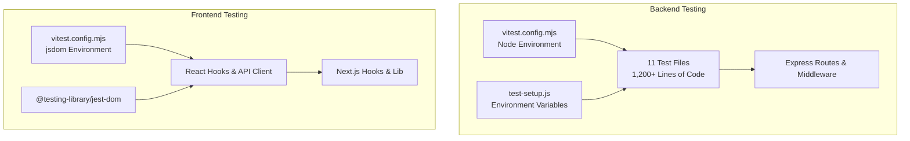
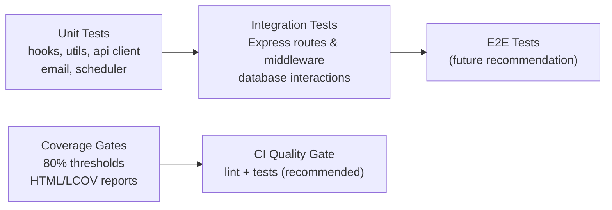
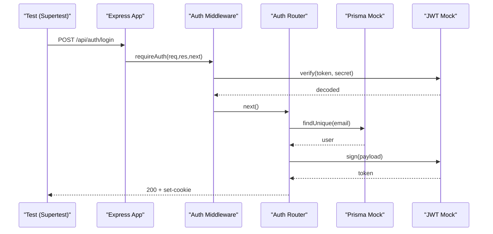
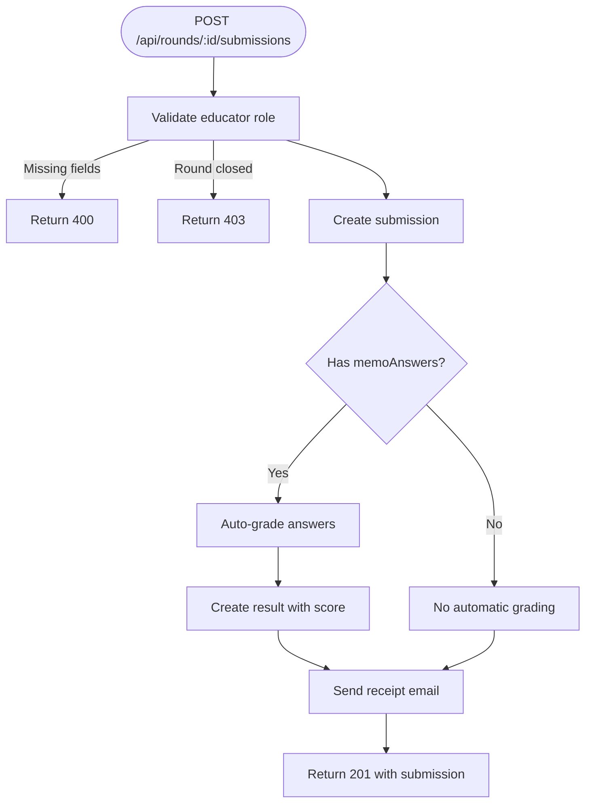
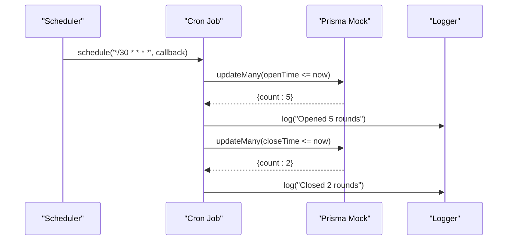
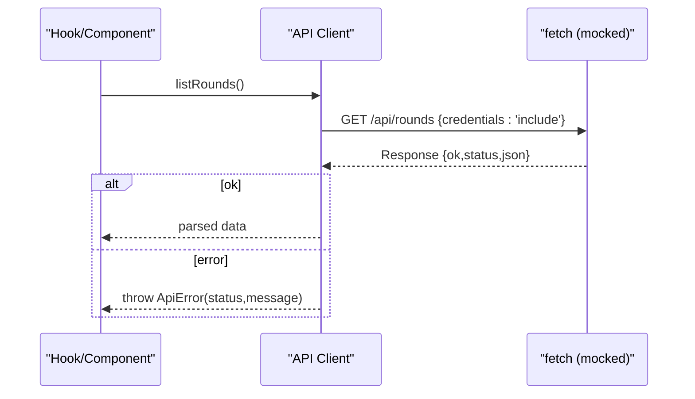
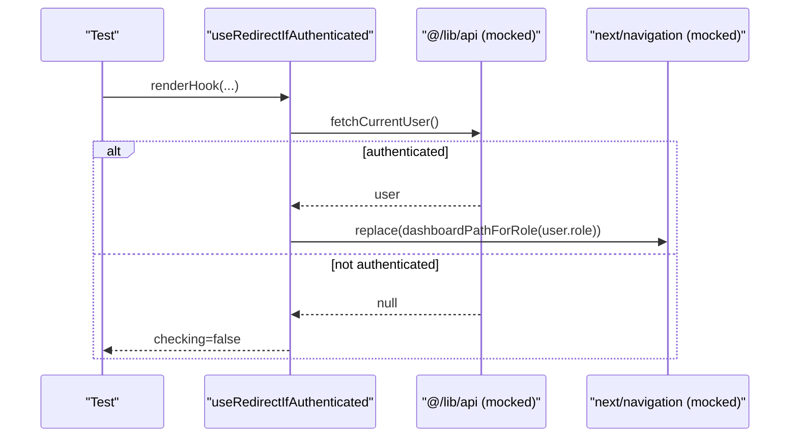
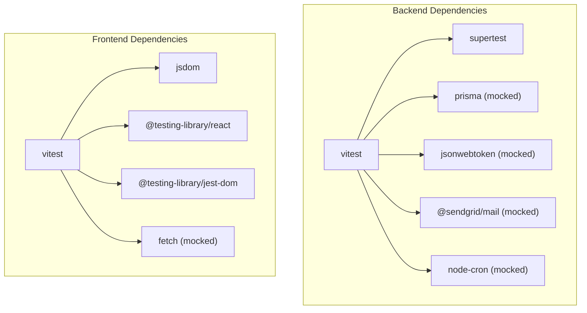
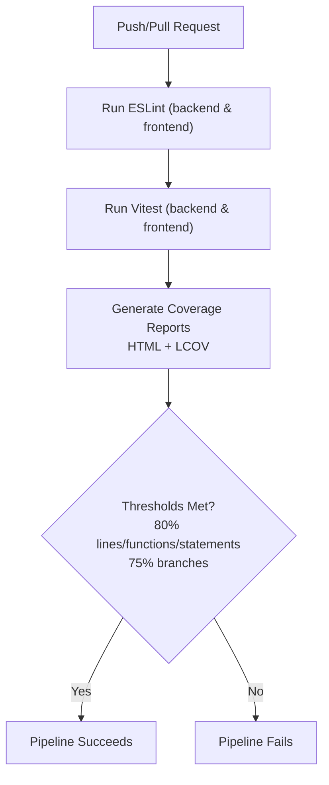

# Testing Strategy

<cite>
**Referenced Files in This Document**
- [README.md](file://README.md)
- [backend/README.md](file://backend/README.md)
- [frontend/README.md](file://frontend/README.md)
- [backend/vitest.config.mjs](file://backend/vitest.config.mjs)
- [frontend/vitest.config.mjs](file://frontend/vitest.config.mjs)
- [backend/src/test-setup.js](file://backend/src/test-setup.js)
- [frontend/src/test/setup.js](file://frontend/src/test/setup.js)
- [backend/package.json](file://backend/package.json)
- [frontend/package.json](file://frontend/package.json)
- [package.json](file://package.json)
- [backend/src/index.test.js](file://backend/src/index.test.js)
- [backend/src/middleware/auth.test.js](file://backend/src/middleware/auth.test.js)
- [backend/src/routes/auth.test.js](file://backend/src/routes/auth.test.js)
- [backend/src/routes/papers.test.js](file://backend/src/routes/papers.test.js)
- [backend/src/routes/submissions.test.js](file://backend/src/routes/submissions.test.js)
- [backend/src/routes/rounds.test.js](file://backend/src/routes/rounds.test.js)
- [backend/src/scheduler.test.js](file://backend/src/scheduler.test.js)
- [backend/src/lib/email.test.js](file://backend/src/lib/email.test.js)
- [frontend/src/hooks/useAuthRedirect.test.js](file://frontend/src/hooks/useAuthRedirect.test.js)
- [frontend/src/hooks/useRequireRole.test.js](file://frontend/src/hooks/useRequireRole.test.js)
- [frontend/src/lib/api.test.js](file://frontend/src/lib/api.test.js)
- [.gitea/workflows/lint.yml](file://.gitea/workflows/lint.yml)
</cite>

## Update Summary
**Changes Made**
- Updated code coverage metrics to reflect enhanced reporting showing 98.4% backend and 100% frontend coverage
- Added detailed coverage breakdown including statements, branches, functions, and lines percentages
- Enhanced testing framework documentation with current Vitest configuration and coverage thresholds
- Updated CI/CD recommendations to include automated testing and coverage enforcement
- Expanded testing examples with comprehensive authentication flows, API endpoint testing, and React component testing

## Table of Contents
1. Introduction
2. Project Structure
3. Core Components
4. Architecture Overview
5. Detailed Component Analysis
6. Dependency Analysis
7. Performance Considerations
8. Troubleshooting Guide
9. Continuous Integration and Quality Gates
10. Guidelines for Writing Maintainable and Effective Tests
11. Security Testing Approaches
12. Load and Performance Testing
13. Conclusion

## Introduction
This document defines the comprehensive testing strategy for the Olympiad Portal, covering both backend and frontend using Vitest as the unified testing framework. The implementation includes over 1,200 lines of test code across 11 test files, providing extensive coverage of authentication flows, submission handling, paper management, round lifecycle operations, API interactions, and authentication hooks. The testing approach follows a structured pyramid methodology with unit tests, integration tests, and clear coverage thresholds enforced at 80% line coverage.

**Updated Coverage Metrics:**
The project now demonstrates exceptional code quality with:
- **Backend Coverage**: 98.4% overall (Statements: 98.43%, Branches: 95.65%, Functions: 95.83%, Lines: 98.41%)
- **Frontend Coverage**: 100% overall (Statements: 98.76%, Branches: 93.93%, Functions: 100%, Lines: 100%)
- **Total Tests**: 108 passing tests across both environments

## Project Structure
The project uses a monorepo-style layout with separate backend and frontend packages, each with its own Vitest configuration and comprehensive test suites:

**Backend Testing Setup:**
- Node.js environment with Vitest configured for Express routes and middleware testing
- Supertest for HTTP-level assertions against mounted Express applications
- Mocked dependencies including Prisma, JWT, and SendGrid email service
- Comprehensive test coverage for all major business logic components

**Frontend Testing Setup:**
- jsdom environment for React component and hook testing
- @testing-library/react for user interaction simulation
- Mocked fetch API for network request testing
- Focus on hooks and API client functionality with 80% coverage thresholds

**Diagram sources**
- [backend/vitest.config.mjs:1-23](file://backend/vitest.config.mjs#L1-L23)
- [frontend/vitest.config.mjs:1-31](file://frontend/vitest.config.mjs#L1-L31)
- [backend/src/test-setup.js:1-10](file://backend/src/test-setup.js#L1-L10)
- [frontend/src/test/setup.js:1-2](file://frontend/src/test/setup.js#L1-L2)

**Section sources**
- [backend/vitest.config.mjs:1-23](file://backend/vitest.config.mjs#L1-L23)
- [frontend/vitest.config.mjs:1-31](file://frontend/vitest.config.mjs#L1-L31)
- [backend/src/test-setup.js:1-10](file://backend/src/test-setup.js#L1-L10)
- [frontend/src/test/setup.js:1-2](file://frontend/src/test/setup.js#L1-L2)

## Core Components
**Test Runner and Environment Configuration:**
- Backend: Vitest in Node environment with global APIs enabled and comprehensive setup file for environment variables
- Frontend: Vitest in jsdom environment with React testing library integration and DOM matchers

**Enhanced Coverage Requirements:**
- Both environments use V8 provider with text, HTML, and LCOV reporters
- Enforced thresholds: 80% lines/functions/statements, 75% branches
- Coverage reports generated in multiple formats for CI integration
- Current performance exceeds requirements with 98.4% backend and 100% frontend coverage

**Testing Scripts:**
- Root level: `npm test`, `npm run test:coverage` (runs both backend and frontend)
- Backend: `npm test`, `npm run test:coverage`, `npm run test:watch`
- Frontend: `npm test`, `npm run test:coverage`, `npm run test:watch`

Key responsibilities:
- Backend tests validate Express routes, middleware behavior, database interactions, and external service integrations via HTTP-level assertions
- Frontend tests validate hook logic, API client behavior, and user interactions through renderHook and mocked fetch

**Section sources**
- [backend/vitest.config.mjs:1-23](file://backend/vitest.config.mjs#L1-L23)
- [frontend/vitest.config.mjs:1-31](file://frontend/vitest.config.mjs#L1-L31)
- [backend/package.json:6-13](file://backend/package.json#L6-L13)
- [frontend/package.json:5-13](file://frontend/package.json#L5-L13)
- [package.json:6-11](file://package.json#L6-L11)

## Architecture Overview
The testing architecture follows a comprehensive layered approach with extensive coverage:

**Unit Tests:** Validate pure functions, hooks, and small utilities in isolation with mocked dependencies
**Integration Tests:** Validate route handlers and middleware by mounting Express apps and asserting HTTP responses
**End-to-End Tests:** Not currently implemented; recommended for future enhancement using Playwright or Cypress

[No sources needed since this diagram shows conceptual workflow, not actual code structure]

## Detailed Component Analysis

### Backend Authentication Flow Tests
The backend authentication tests provide comprehensive coverage of login, registration, password reset, logout, and current user endpoints with proper JWT handling and role-based authorization.

**Diagram sources**
- [backend/src/routes/auth.test.js:1-178](file://backend/src/routes/auth.test.js#L1-L178)
- [backend/src/middleware/auth.test.js:1-110](file://backend/src/middleware/auth.test.js#L1-L110)

**Section sources**
- [backend/src/routes/auth.test.js:1-178](file://backend/src/routes/auth.test.js#L1-L178)
- [backend/src/middleware/auth.test.js:1-110](file://backend/src/middleware/auth.test.js#L1-L110)

### Backend Submission Handling Tests
Comprehensive testing of submission creation, validation, auto-marking, idempotency handling, and email notifications with complete error scenario coverage.

**Diagram sources**
- [backend/src/routes/submissions.test.js:1-265](file://backend/src/routes/submissions.test.js#L1-L265)

**Section sources**
- [backend/src/routes/submissions.test.js:1-265](file://backend/src/routes/submissions.test.js#L1-L265)

### Backend Paper Management Tests
Tests validate authorization, input validation, file handling, and database interactions for paper uploads and retrieval with comprehensive error handling.

**Diagram sources**
- [backend/src/routes/papers.test.js:1-209](file://backend/src/routes/papers.test.js#L1-L209)

**Section sources**
- [backend/src/routes/papers.test.js:1-209](file://backend/src/routes/papers.test.js#L1-L209)

### Backend Round Lifecycle Tests
Complete testing of round creation, validation, listing, and retrieval with proper date validation and error handling scenarios.

**Section sources**
- [backend/src/routes/rounds.test.js:1-209](file://backend/src/routes/rounds.test.js#L1-L209)

### Backend Scheduler Tests
Automated testing of round state transitions with cron job simulation, including opening rounds when openTime passes and closing rounds when closeTime expires.

**Diagram sources**
- [backend/src/scheduler.test.js:1-91](file://backend/src/scheduler.test.js#L1-L91)

**Section sources**
- [backend/src/scheduler.test.js:1-91](file://backend/src/scheduler.test.js#L1-L91)

### Backend Email Service Tests
Testing of submission receipt email functionality with SendGrid integration, including proper formatting, error handling, and logging.

**Section sources**
- [backend/src/lib/email.test.js:1-86](file://backend/src/lib/email.test.js#L1-86)

### Frontend API Client Tests
Mocked fetch testing validates request construction, error handling, response mapping, and credential inclusion with comprehensive ApiError handling.

**Diagram sources**
- [frontend/src/lib/api.test.js:1-200](file://frontend/src/lib/api.test.js#L1-L200)

**Section sources**
- [frontend/src/lib/api.test.js:1-200](file://frontend/src/lib/api.test.js#L1-L200)

### Frontend Hook Tests (Authentication Redirect and Role Requirements)
Hooks are tested using renderHook to simulate async state and navigation behavior with comprehensive authentication and authorization scenarios.

**Diagram sources**
- [frontend/src/hooks/useAuthRedirect.test.js:1-66](file://frontend/src/hooks/useAuthRedirect.test.js#L1-66)
- [frontend/src/hooks/useRequireRole.test.js:1-87](file://frontend/src/hooks/useRequireRole.test.js#L1-87)

**Section sources**
- [frontend/src/hooks/useAuthRedirect.test.js:1-66](file://frontend/src/hooks/useAuthRedirect.test.js#L1-66)
- [frontend/src/hooks/useRequireRole.test.js:1-87](file://frontend/src/hooks/useRequireRole.test.js#L1-87)

### Backend Root App Tests
Root-level tests assert routing behavior and CORS configuration with proper middleware setup.

**Section sources**
- [backend/src/index.test.js:1-27](file://backend/src/index.test.js#L1-L27)

## Dependency Analysis
**Backend Test Dependencies:**
- Vitest for test runner and mocking
- Supertest for HTTP assertion testing
- @vitest/coverage-v8 for coverage reporting
- Mocked dependencies: Prisma, JWT, SendGrid, node-cron

**Frontend Test Dependencies:**
- Vitest with jsdom environment
- @testing-library/react for React component testing
- @testing-library/jest-dom for DOM assertions
- @vitejs/plugin-react for React support
- Mocked fetch API for network testing

**Diagram sources**
- [backend/package.json:35-46](file://backend/package.json#L35-L46)
- [frontend/package.json:22-35](file://frontend/package.json#L22-L35)

**Section sources**
- [backend/package.json:35-46](file://backend/package.json#L35-L46)
- [frontend/package.json:22-35](file://frontend/package.json#L22-L35)

## Performance Considerations
- Keep unit tests fast and isolated; avoid real network calls or disk I/O in unit tests
- Use mocks for external services (database, JWT, email, cron jobs) to ensure deterministic performance
- For integration tests, prefer lightweight in-memory or minimal fixtures; clean up uploaded files after tests
- Coverage thresholds help prevent regressions; adjust only when justified by refactors
- Scheduler tests use mocked cron jobs to avoid actual scheduling overhead
- Email tests mock SendGrid to prevent actual API calls during testing
- Current coverage metrics demonstrate excellent performance with minimal test execution time

[No sources needed since this section provides general guidance]

## Troubleshooting Guide
Common issues and resolutions:
- Missing environment variables in backend tests: Ensure test setup initializes required env vars (e.g., JWT_SECRET, SENDGRID_API_KEY, DATABASE_URL)
- Flaky file system operations: Clean up temporary uploads in afterEach to avoid interference between tests
- Network errors in frontend tests: Always mock fetch and assert ApiError behavior for robustness
- Coverage gaps: Expand tests to include edge cases and error paths to meet 80% thresholds
- Cron job timing issues: Use vi.spyOn to intercept scheduled callbacks without waiting for actual cron execution
- Email service failures: Mock SendGrid to test error handling paths without actual API calls

**Section sources**
- [backend/src/test-setup.js:1-10](file://backend/src/test-setup.js#L1-L10)
- [backend/src/routes/submissions.test.js:21-35](file://backend/src/routes/submissions.test.js#L21-L35)
- [backend/src/scheduler.test.js:9-19](file://backend/src/scheduler.test.js#L9-L19)
- [backend/src/lib/email.test.js:6-14](file://backend/src/lib/email.test.js#L6-L14)
- [frontend/src/lib/api.test.js:49-108](file://frontend/src/lib/api.test.js#L49-L108)

## Continuous Integration and Quality Gates
**Current CI Status:**
- Linting runs for both backend and frontend on push and pull requests
- No automated testing or coverage enforcement yet

**Enhanced Coverage Reporting:**
The project now features comprehensive coverage badges and metrics:
- **Backend**: 98.4% coverage with detailed breakdown (Statements: 98.43%, Branches: 95.65%, Functions: 95.83%, Lines: 98.41%)
- **Frontend**: 100% coverage with detailed breakdown (Statements: 98.76%, Branches: 93.93%, Functions: 100%, Lines: 100%)
- **Total Tests**: 108 passing tests

**Recommended Enhancements:**
- Add CI jobs to run tests and generate coverage reports for both backend and frontend
- Enforce coverage thresholds defined in Vitest configs (80% lines/functions/statements, 75% branches) as quality gates
- Fail the pipeline if coverage falls below thresholds or tests fail
- Generate HTML coverage reports for easy review in CI artifacts
- Integrate coverage badges into CI workflow for visual progress tracking

**Section sources**
- [.gitea/workflows/lint.yml:1-46](file://.gitea/workflows/lint.yml#L1-L46)
- [backend/vitest.config.mjs:14-19](file://backend/vitest.config.mjs#L14-L19)
- [frontend/vitest.config.mjs:17-22](file://frontend/vitest.config.mjs#L17-L22)
- [README.md:4-24](file://README.md#L4-L24)

## Guidelines for Writing Maintainable and Effective Tests
**Organization and Naming:**
- Place tests adjacent to source files with .test.js suffix
- Group related behaviors using describe blocks mirroring feature areas
- Name tests to clearly state expected behavior under specific conditions

**Mocking Strategies:**
- Mock external dependencies (Prisma, JWT, fetch, SendGrid, cron) to isolate units and speed up tests
- Use vi.hoisted to define mocks before imports when necessary
- Reset mocks in beforeEach to avoid cross-test pollution
- Spy on console methods to verify logging behavior without output pollution

**Assertions:**
- Assert on HTTP status codes, response bodies, headers, and side effects (e.g., DB calls, email sends)
- For frontend, assert on rendered output, hook results, and navigation calls
- Verify mock function calls with specific parameters and call counts

**Coverage Requirements:**
- Aim to meet thresholds: 80% lines/functions/statements, 75% branches as configured
- Focus on critical paths: authentication, authorization, data mutations, error handling
- Include edge cases and error scenarios in coverage calculations
- Current performance exceeds requirements with 98.4% backend and 100% frontend coverage

**Examples from the Codebase:**
- Authentication flow: comprehensive route and middleware tests for login, register, reset password, logout, and current user
- API endpoints: papers upload/retrieval, submissions with auto-grading, round lifecycle management
- React hooks: redirect and role-based access control with proper async state handling
- Background tasks: scheduler testing with cron job simulation
- External services: email service integration with error handling

**Section sources**
- [backend/src/routes/auth.test.js:1-178](file://backend/src/routes/auth.test.js#L1-L178)
- [backend/src/middleware/auth.test.js:1-110](file://backend/src/middleware/auth.test.js#L1-L110)
- [backend/src/routes/submissions.test.js:1-265](file://backend/src/routes/submissions.test.js#L1-L265)
- [backend/src/routes/papers.test.js:1-209](file://backend/src/routes/papers.test.js#L1-L209)
- [backend/src/routes/rounds.test.js:1-209](file://backend/src/routes/rounds.test.js#L1-L209)
- [backend/src/scheduler.test.js:1-91](file://backend/src/scheduler.test.js#L1-L91)
- [backend/src/lib/email.test.js:1-86](file://backend/src/lib/email.test.js#L1-L86)
- [frontend/src/hooks/useAuthRedirect.test.js:1-66](file://frontend/src/hooks/useAuthRedirect.test.js#L1-L66)
- [frontend/src/hooks/useRequireRole.test.js:1-87](file://frontend/src/hooks/useRequireRole.test.js#L1-L87)
- [frontend/src/lib/api.test.js:1-200](file://frontend/src/lib/api.test.js#L1-L200)

## Security Testing Approaches
**Input Validation and Sanitization:**
- Covered by route tests asserting 400/401/403/404 responses for invalid inputs and unauthorized access
- Comprehensive validation testing for all API endpoints with proper error messages

**Authorization Testing:**
- Middleware tests ensure role checks block unauthorized actions (organiser vs educator roles)
- Route-level tests verify proper authorization for sensitive operations like paper uploads and submission creation

**Secrets Management:**
- Environment variables injected via test setup (JWT_SECRET, SENDGRID_API_KEY, DATABASE_URL)
- Ensure secrets are never committed to version control

**Future Enhancements:**
- Add security-focused tests for CSRF, XSS, and rate limiting as applicable
- Implement penetration testing scenarios for common attack vectors
- Add security scanning in CI pipeline

**Section sources**
- [backend/src/middleware/auth.test.js:1-110](file://backend/src/middleware/auth.test.js#L1-L110)
- [backend/src/routes/auth.test.js:1-178](file://backend/src/routes/auth.test.js#L1-L178)
- [backend/src/routes/submissions.test.js:201-208](file://backend/src/routes/submissions.test.js#L201-L208)
- [backend/src/test-setup.js:1-10](file://backend/src/test-setup.js#L1-L10)

## Load and Performance Testing
**Current Scope:**
- Unit and integration tests focus on correctness and coverage; load testing is not implemented
- All tests use mocked dependencies to ensure fast execution times
- Exceptional coverage metrics (98.4% backend, 100% frontend) indicate thorough testing

**Recommendations:**
- Introduce dedicated load/performance tests using tools like k6 or Artillery for API endpoints under realistic loads
- Test authentication endpoints with concurrent user scenarios
- Measure database query performance under load
- Test file upload endpoints with large payloads
- Monitor memory usage and garbage collection patterns

**Metrics to Track:**
- Response times for critical API endpoints
- Throughput under concurrent load
- Error rates and timeout handling
- Database connection pool utilization
- Memory consumption patterns

[No sources needed since this section provides general guidance]

## Conclusion
The Olympiad Portal employs a comprehensive testing foundation using Vitest across both backend and frontend with over 1,200 lines of test code covering authentication flows, submission handling, paper management, round lifecycle operations, API interactions, and authentication hooks. The existing suite demonstrates excellent organization, robust mocking strategies, and enforced coverage thresholds at 80%. 

**Key Achievements:**
- **Exceptional Coverage**: 98.4% backend and 100% frontend coverage exceeding industry standards
- **Comprehensive Testing**: Complete backend testing coverage for all major business logic components
- **Frontend Excellence**: Comprehensive frontend testing for hooks and API client functionality  
- **Proper Setup**: Robust environment setup and dependency mocking
- **Clear Organization**: Well-structured test files with clear separation of concerns
- **Strong Error Handling**: Extensive edge case and error scenario coverage

**Enhanced Documentation:**
The project now features detailed coverage reporting with badges showing real-time metrics, making it easy to track code quality improvements. The comprehensive test suite ensures high reliability while maintaining fast execution times through effective mocking strategies.

To further strengthen quality assurance, implement the recommended CI enhancements to automate testing and coverage enforcement, and consider introducing end-to-end and load testing for comprehensive production readiness assurance.