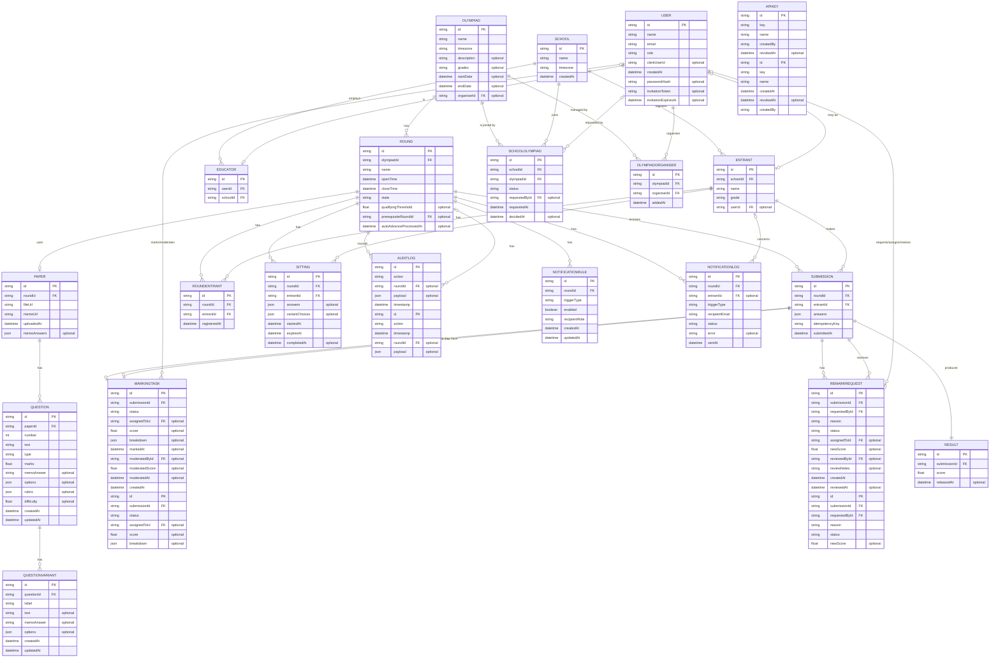

# Database Schema

The database is PostgreSQL, hosted on Supabase — the choice of host and the reasoning are in the [Tech Stack](./tech-stack.md). `backend/prisma/schema.prisma` is the single source of truth: every model change becomes a timestamped SQL migration under `backend/prisma/migrations/`, reviewed in a pull request like any code change.

## Entity relationship diagram

## Tables

### Olympiad
Top-level competition. Has many rounds, each on its own schedule. The optional `description`, `grades`, `startDate` and `endDate` fields are organiser-set info, shown to educators on the olympiad info card before their school joins. The optional `organiserId` references the user who created the olympiad.

### Round
The core state machine: `scheduled → open → closed → released`, driven by a scheduler comparing the current time against `openTime`/`closeTime`. Everything else in the system depends on this table's state. Rounds can also gate entry: `qualifyingThreshold` (the minimum score to pass) and `prerequisiteRoundId` (a round that must be passed first) drive automatic advancement — when a round closes, the scheduler registers qualifying entrants into the next round, and `autoAdvanceProcessedAt` keeps that transition exactly-once.

### School
A registered school competing in the olympiad. Has many educators and entrants.

### SchoolOlympiad
A school's participation in an olympiad, gated by organiser approval — the school is "part of" an olympiad exactly when its row here has `status: 'approved'`, which is what unlocks registering entrants into that olympiad's rounds. `status` moves `pending → approved | declined`, and a declined school can re-request (the upsert flips the row back to `pending`). A unique constraint on `(schoolId, olympiadId)` keeps one row per school per olympiad, and `requestedById` records which educator asked. The migration that introduced this table backfilled every existing participation to `approved`, so schools that were already competing kept their access.

### User
Login account for anyone — organiser, educator, or student. `name` is the user's display name, required at registration. Public registration only ever creates `educator` accounts - organiser accounts are provisioned directly by the team. Educators and organisers authenticate through Clerk (`clerkUserId`); students instead receive an invitation (`invitationToken`, expiring at `invitationExpiresAt`) and set a `passwordHash`, then sign in with email and password for a JWT.

### Educator
Links a `User` account to a `School`. Educators upload results on behalf of their entrants.

### Entrant
A competing student, registered against a school. An entrant may be linked to a `User` account so the student can sign in and see their own sittings and results — educators create entrant records before any student account exists, so the link (made through the claim-code flow at student registration) is optional. The optional `userId` field is that link.

### Paper
A round's uploaded test and memo. Download is gated by the round's current state — not accessible before `open`. `memoAnswers` stores the answer key as structured JSON (question number → correct answer), separate from the memo PDF, since automarking needs data it can read programmatically. A paper can additionally carry a structured question bank (`Question` rows) for online sittings — separate from, and in addition to, the uploaded PDFs.

### Question
A structured question in a paper's question bank — the data behind online sittings, distinct from the uploaded PDF. A unique constraint on `(paperId, number)` keeps one question per number per paper. `type` is one of `multiple_choice`, `short_answer`, `essay` or `numeric`; `memoAnswer` drives automarking, `options` holds MCQ choices as JSON, and `rubric` carries marking guidance for the manually-marked types. `difficulty` is the question's success rate (0.0–1.0), recalculated from variant-aware results when a round closes and again when results are released; `null` means no data yet. Memo answers and rubrics are never sent to students.

### QuestionVariant
An alternative version of a question — the anti-collusion mechanism for online sittings. A variant can override the question's `text`, `memoAnswer` and `options`; a `null` text falls back to the parent question. A unique constraint on `(questionId, label)` keeps one variant per label. When a sitting starts, each entrant is assigned one variant per question deterministically (a hash of the entrant and question ids) and the choices are stored in `Sitting.variantChoices` — the same entrant always gets the same variant, but two students sitting side by side see different papers. Automarking prefers the assigned variant's `memoAnswer`.

### Submission
An educator's results for their entrants. `idempotencyKey` prevents the same submission being recorded twice on retry. A submission may also enter the manual-marking workflow (`MarkingTask`) and receive appeals (`RemarkRequest`).

### RoundEntrant
Tracks which entrants are registered to sit a specific round — required since the brief specifies entrants are put forward and registered against individual rounds, not just against the olympiad generally. A unique constraint on `(roundId, entrantId)` prevents duplicate registration. This table is what powers the "Submit Results" flow — an educator's submission page lists only entrants registered for that round.

### Sitting
An entrant's online test-taking session for a round — the online counterpart to sitting the paper physically. A unique constraint on `(roundId, entrantId)` enforces one sitting per entrant per round; requesting a sitting again returns the existing in-progress one, so a reconnect resumes where the student left off. `answers` holds the student's auto-saved work as they type, `expiresAt` mirrors the round's `closeTime`, and `completedAt` is set once the sitting is submitted. `variantChoices` records which variant of each question this entrant was assigned (a JSON map of question id → variant id), fixed deterministically when the sitting starts.

### Result
The mark for a submission. `releasedAt` stays empty until the round closes, so scores aren't visible to schools early.

### MarkingTask
A submission queued for manual marking — the workflow for answers automarking can't score. One-to-one with its `Submission` (`submissionId` is unique). Progresses `unassigned → assigned → marked → moderated`; `assignedToId` records the marker, `moderatedById` the moderator, and `breakdown` stores per-question partial credit as JSON.

### RemarkRequest
An educator's appeal against a marked submission. `requestedById` is the appealing educator; status moves `pending → assigned → approved | rejected` under an assigned organiser reviewer. On approval the `newScore` replaces the result's score and qualification-based advancement is re-evaluated atomically in the same transaction.

### NotificationRule
A per-round toggle for each of the four notification triggers (`before_open`, `before_close`, `missing_submission`, `results_released`). Organisers configure these per round from the organiser console; a unique constraint on `(roundId, triggerType)` keeps one rule per trigger per round. Absence of a rule means the trigger is **enabled** — rounds created before this feature existed keep behaving exactly as before, since the scheduler's enablement check treats a missing row as on.

`recipientRole` (`educator` | `organiser` | `all`) is stored for future targeting but does not yet filter recipients: nothing in the data model identifies which organiser owns a round, so every notification currently goes to educators.

### NotificationLog
The delivery record that makes each notification exactly-once per recipient. Before sending, the scheduler checks for a log row with the same `(roundId, triggerType, recipientEmail)` — the table's unique constraint — and skips if one exists. That is what stops a scheduler ticking every 30 seconds from re-sending the same reminder, and what makes re-running after a crash safe. `status` records `sent` or `failed` with the error message kept for debugging; `entrantId` is set only on `missing_submission` logs, to identify whose submission is missing.

### OlympiadOrganiser
A join table that records which organisers have access to which olympiads. Every organiser — including the creator — gets a row here so that access checks go through a single membership lookup instead of a mix of `organiserId` comparisons and role checks. A unique constraint on `(olympiadId, organiserId)` keeps one row per pair.

**Access rules:**
- **Adding:** Any existing organiser of an olympiad can add another user with role `organiser` as a co-organiser.
- **Removing:** Any existing organiser can remove a co-organiser, but the **creator** (the user referenced by `Olympiad.organiserId`) is never removable — not even by themselves.
- **Backfill:** The migration that introduced this table inserted a row for every existing `Olympiad.organiserId`, so no creator lost access.
- **Creation flow:** When a new olympiad is created, the creator is automatically added to this table.

### Question
A question in a paper's question bank. Each question has a `number` (position within the paper), `text` (the question content), `type` (`multiple_choice` | `short_answer` | `essay` | `numeric`), `marks` (maximum score), and optional `memoAnswer` (correct answer for auto-marking). MCQ questions store their options in `options` as JSON; essay/short-answer questions store their marking rubric in `rubric`. `difficulty` tracks the success rate (0.0-1.0) based on student attempts, updated as more sittings complete. A unique constraint on `(paperId, number)` keeps questions ordered within a paper.

### QuestionVariant
A per-question variant for automarking — allows different students to receive different versions of the same question. Each variant has a `label` (e.g. "Variant A"), optional `text` (null = use parent question text), optional `memoAnswer`, and optional `options`. A unique constraint on `(questionId, label)` keeps one variant per label per question.

### MarkingTask
The manual marking workflow for submissions that require human grading (essay/short-answer questions). Each submission gets one `MarkingTask` row. `status` moves `unassigned → assigned → marked → moderated`. `assignedToId` references the educator doing the marking; `score` and `breakdown` (per-question partial credit as JSON) are set when marking completes. `moderatedById`, `moderatedScore`, and `moderatedAt` track the moderation step. A unique constraint on `submissionId` keeps one task per submission.

### RemarkRequest
An appeal/remark workflow for students or educators contesting a mark. Each request has a `reason`, `status` (`pending` | `assigned` | `approved` | `rejected`), and optional `assignedToId` (the reviewer). When approved, `newScore` is set. `reviewedById` and `reviewNotes` record the decision. Indexes on `(assignedToId, status)` speed up the organiser's remark queue.

### AuditLog
One row per automatic action the scheduler performs on a round — `round_opened`, `round_closed`, `auto_advanced`, `notification_sent`, `entrants_registered` — with a JSON `payload` for detail. This is what the organiser audit log and round replay timeline read.

### ApiKey
An organiser-issued key granting external consumers read-only access to the public API. `revokedAt` staying `null` means the key is active; revocation takes effect immediately because every request re-checks it.

## Co-organiser model

The co-organiser model lets multiple organisers share management of an olympiad. Before this feature, only the creator (via `Olympiad.organiserId`) could manage an olympiad. Now, any user listed in the `OlympiadOrganiser` table for an olympiad can:

- Edit the olympiad's details (name, dates, description)
- Create and manage rounds
- Upload papers and configure notifications
- View all entrant data, submissions, standings, audit logs, and replay timelines
- Add or remove other co-organisers (except the creator)
- Approve or decline school access requests
- Manage remark requests and marking tasks for the olympiad

**Authorization:** All routes that operate on olympiad-scoped resources (rounds, papers, submissions, standings, audit logs, replay, notifications, remark requests, marking tasks) check `OlympiadOrganiser` membership before granting access. This prevents cross-olympiad access — an organiser of Olympiad A cannot view or modify data from Olympiad B unless they are also listed as an organiser of Olympiad B.

The `GET /api/olympiads` endpoint returns olympiads where the authenticated organiser is either the creator or listed in `OlympiadOrganiser`. The `PUT /api/olympiads/:id` endpoint checks membership before allowing edits. Similarly, all round-level operations verify that the organiser is a member of the round's parent olympiad.

## Deliberate omissions

**Certificates have no table.** A certificate is generated on the fly as a PDF (via `pdfkit`) from the entrant, round and released result each time `GET /api/rounds/:id/certificates/:entrantId` is called. Nothing about a certificate is stateful — the same inputs always produce the same document — so persisting it would add a stale-copy risk and storage cost for no benefit.

**Standings have no table either.** They are computed from `Result` rows on request, so a ranking can never disagree with the marks it summarises.
