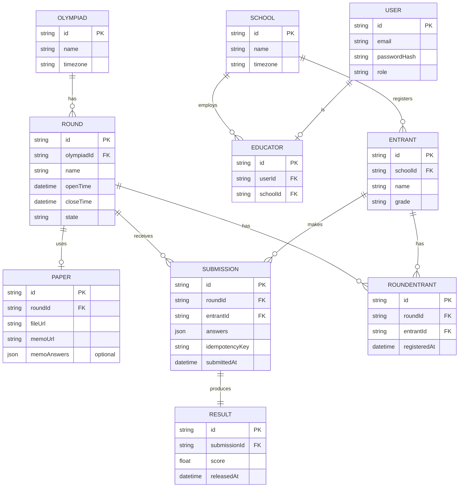

# Database Schema

## Entity relationship diagram

## Tables

### Olympiad
Top-level competition. Has many rounds, each on its own schedule.

### Round
The core state machine: `scheduled → open → closed → released`, driven by a scheduler comparing the current time against `openTime`/`closeTime`. Everything else in the system depends on this table's state.

### School
A registered school competing in the olympiad. Has many educators and entrants.

### User
Login account for anyone — organiser, educator, or student. Password handling goes through our auth library, not custom code.

### Educator
Links a `User` account to a `School`. Educators upload results on behalf of their entrants.

### Entrant
A competing student, registered against a school.

### Paper
A round's uploaded test and memo. Download is gated by the round's current state — not accessible before `open`. `memoAnswers` stores the answer key as structured JSON (question number → correct answer), separate from the memo PDF, since automarking needs data it can read programmatically.

### Submission
An educator's results for their entrants. `idempotencyKey` prevents the same submission being recorded twice on retry.

### RoundEntrant
Tracks which entrants are registered to sit a specific round — required since the brief specifies entrants are put forward and registered against individual rounds, not just against the olympiad generally. A unique constraint on `(roundId, entrantId)` prevents duplicate registration. This table is what powers the "Submit Results" flow — an educator's submission page lists only entrants registered for that round.

### Result
The mark for a submission. `releasedAt` stays empty until the round closes, so scores aren't visible to schools early.