# Database Schema

The database is PostgreSQL, hosted on Supabase — the choice of host and the reasoning are in the [Tech Stack](./tech-stack.md). `backend/prisma/schema.prisma` is the single source of truth: every model change becomes a timestamped SQL migration under `backend/prisma/migrations/`, reviewed in a pull request like any code change.

## Entity relationship diagram

```mermaid
erDiagram
  OLYMPIAD ||--o{ ROUND : has
  ROUND ||--o| PAPER : uses
  ROUND ||--o{ SUBMISSION : receives
  ROUND ||--o{ ROUNDENTRANT : has
  ROUND ||--o{ SITTING : has
  SCHOOL ||--o{ EDUCATOR : employs
  SCHOOL ||--o{ ENTRANT : registers
  USER ||--o| EDUCATOR : is
  ENTRANT ||--o{ SUBMISSION : makes
  ENTRANT ||--o{ ROUNDENTRANT : has
  ENTRANT ||--o{ SITTING : takes
  SUBMISSION ||--|| RESULT : produces
  USER |o--o| ENTRANT : "may be"
  ROUND ||--o{ NOTIFICATIONRULE : has
  ROUND ||--o{ NOTIFICATIONLOG : has
  ENTRANT |o--o{ NOTIFICATIONLOG : concerns
  OLYMPIAD ||--o{ SCHOOLOLYMPIAD : "is joined by"
  SCHOOL ||--o{ SCHOOLOLYMPIAD : "joins"
  USER |o--o{ SCHOOLOLYMPIAD : "requested by"
  OLYMPIAD ||--o{ OLYMPIADORGANISER : "managed by"
  USER ||--o{ OLYMPIADORGANISER : "organises"

  OLYMPIAD {
    string id PK
    string name
    string timezone
    string description "optional"
    string grades "optional"
    datetime startDate "optional"
    datetime endDate "optional"
  }
  ROUND {
    string id PK
    string olympiadId FK
    string name
    datetime openTime
    datetime closeTime
    string state
  }
  SCHOOL {
    string id PK
    string name
    string timezone
  }
  SCHOOLOLYMPIAD {
    string id PK
    string schoolId FK
    string olympiadId FK
    string status
    string requestedById FK "optional"
    datetime requestedAt
    datetime decidedAt "optional"
  }
  USER {
    string id PK
    string name
    string email
    string role
    string clerkUserId
  }
  EDUCATOR {
    string id PK
    string userId FK
    string schoolId FK
  }
  ENTRANT {
    string id PK
    string schoolId FK
    string name
    string grade
  }
  PAPER {
    string id PK
    string roundId FK
    string fileUrl
    string memoUrl
    json memoAnswers "optional"
  }
  SUBMISSION {
    string id PK
    string roundId FK
    string entrantId FK
    json answers
    string idempotencyKey
    datetime submittedAt
  }
  RESULT {
    string id PK
    string submissionId FK
    float score
    datetime releasedAt
  }
  ROUNDENTRANT {
    string id PK
    string roundId FK
    string entrantId FK
    datetime registeredAt
  }
  SITTING {
    string id PK
    string roundId FK
    string entrantId FK
    json answers "optional"
    datetime startedAt
    datetime expiresAt
    datetime completedAt "optional"
  }
  NOTIFICATIONRULE {
    string id PK
    string roundId FK
    string triggerType
    boolean enabled
    string recipientRole
    datetime createdAt
    datetime updatedAt
  }
  NOTIFICATIONLOG {
    string id PK
    string roundId FK
    string entrantId FK "optional"
    string triggerType
    string recipientEmail
    string status
    string error "optional"
    datetime sentAt
  }
  OLYMPIADORGANISER {
    string id PK
    string olympiadId FK
    string organiserId FK
    datetime addedAt
  }
```

## Tables

### Olympiad
Top-level competition. Has many rounds, each on its own schedule. The optional `description`, `grades`, `startDate` and `endDate` fields are organiser-set info, shown to educators on the olympiad info card before their school joins.

### Round
The core state machine: `scheduled → open → closed → released`, driven by a scheduler comparing the current time against `openTime`/`closeTime`. Everything else in the system depends on this table's state.

### School
A registered school competing in the olympiad. Has many educators and entrants.

### SchoolOlympiad
A school's participation in an olympiad, gated by organiser approval — the school is "part of" an olympiad exactly when its row here has `status: 'approved'`, which is what unlocks registering entrants into that olympiad's rounds. `status` moves `pending → approved | declined`, and a declined school can re-request (the upsert flips the row back to `pending`). A unique constraint on `(schoolId, olympiadId)` keeps one row per school per olympiad, and `requestedById` records which educator asked. The migration that introduced this table backfilled every existing participation to `approved`, so schools that were already competing kept their access.

### User
Login account for anyone — organiser, educator, or student. `name` is the user's display name, required at registration. Password handling goes through our auth library, not custom code. Public registration only ever creates `educator` accounts - organiser accounts are provisioned directly by the team.

### Educator
Links a `User` account to a `School`. Educators upload results on behalf of their entrants.

### Entrant
A competing student, registered against a school. An entrant may be linked to a `User` account so the student can sign in and see their own sittings and results — educators create entrant records before any student account exists, so the link (made through the claim-code flow at student registration) is optional.

### Paper
A round's uploaded test and memo. Download is gated by the round's current state — not accessible before `open`. `memoAnswers` stores the answer key as structured JSON (question number → correct answer), separate from the memo PDF, since automarking needs data it can read programmatically.

### Submission
An educator's results for their entrants. `idempotencyKey` prevents the same submission being recorded twice on retry.

### RoundEntrant
Tracks which entrants are registered to sit a specific round — required since the brief specifies entrants are put forward and registered against individual rounds, not just against the olympiad generally. A unique constraint on `(roundId, entrantId)` prevents duplicate registration. This table is what powers the "Submit Results" flow — an educator's submission page lists only entrants registered for that round.

### Sitting
An entrant's online test-taking session for a round — the online counterpart to sitting the paper physically. A unique constraint on `(roundId, entrantId)` enforces one sitting per entrant per round; requesting a sitting again returns the existing in-progress one, so a reconnect resumes where the student left off. `answers` holds the student's auto-saved work as they type, `expiresAt` mirrors the round's `closeTime`, and `completedAt` is set once the sitting is submitted.

### Result
The mark for a submission. `releasedAt` stays empty until the round closes, so scores aren't visible to schools early.

### NotificationRule
A per-round toggle for each of the four notification triggers (`before_open`, `before_close`, `missing_submission`, `results_released`). Organisers configure these per round from the organiser console; a unique constraint on `(roundId, triggerType)` keeps one rule per trigger per round. Absence of a rule means the trigger is **enabled** — rounds created before this feature existed keep behaving exactly as before, since the scheduler's enablement check treats a missing row as on.

`recipientRole` (`educator` | `organiser` | `all`) is stored for future targeting but does not yet filter recipients: nothing in the data model identifies which organiser owns a round, so every notification currently goes to educators.

### NotificationLog
The delivery record that makes each notification exactly-once per recipient. Before sending, the scheduler checks for a log row with the same `(roundId, triggerType, recipientEmail)` — the table's unique constraint — and skips if one exists. That is what stops a scheduler ticking every 30 seconds from re-sending the same reminder, and what makes re-running after a crash safe. `status` records `sent` or `failed` with the error message kept for debugging; `entrantId` is set only on `missing_submission` logs, to identify whose submission is missing.

### OlympiadOrganiser
A join table that records which organisers have access to which olympiads. Every organiser — including the creator — gets a row here so that access checks go through a single membership lookup instead of a mix of `organiserId` comparisons and role checks. A unique constraint on `(olympiadId, organiserId)` keeps one row per pair.

**Access rules:**
- **Adding:** Any existing organiser of an olympiad can add another user with role `organiser` as a co-organiser.
- **Removing:** Any existing organiser can remove a co-organiser, but the **creator** (the user referenced by `Olympiad.organiserId`) is never removable — not even by themselves.
- **Backfill:** The migration that introduced this table inserted a row for every existing `Olympiad.organiserId`, so no creator lost access.
- **Creation flow:** When a new olympiad is created, the creator is automatically added to this table.

## Co-organiser model

The co-organiser model lets multiple organisers share management of an olympiad. Before this feature, only the creator (via `Olympiad.organiserId`) could manage an olympiad. Now, any user listed in the `OlympiadOrganiser` table for an olympiad can:

- Edit the olympiad's details (name, dates, description)
- Create and manage rounds
- Upload papers and configure notifications
- View all entrant data, submissions, and standings
- Add or remove other co-organisers (except the creator)

The `GET /api/olympiads` endpoint returns olympiads where the authenticated organiser is either the creator or listed in `OlympiadOrganiser`. The `PUT /api/olympiads/:id` endpoint checks membership before allowing edits.

## Deliberate omissions

**Certificates have no table.** A certificate is generated on the fly as a PDF (via `pdfkit`) from the entrant, round and released result each time `GET /api/rounds/:id/certificates/:entrantId` is called. Nothing about a certificate is stateful — the same inputs always produce the same document — so persisting it would add a stale-copy risk and storage cost for no benefit.

**Standings have no table either.** They are computed from `Result` rows on request, so a ranking can never disagree with the marks it summarises.