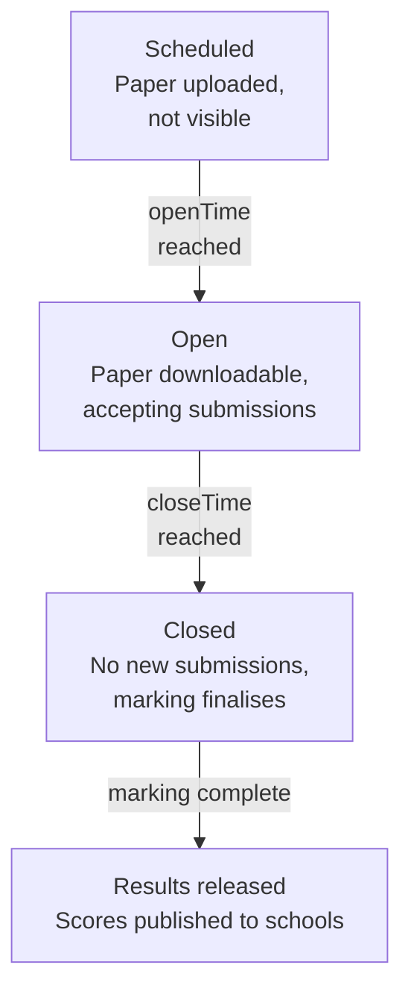

# Round Lifecycle

The round lifecycle is the core of the portal — every other feature (paper access, submissions, automarking, results) depends on a round's current state. States move automatically, driven by a scheduler comparing the current time to each round's stored `openTime` and `closeTime`. Nobody presses a button to open or close a round.

## States

- **Scheduled** — the round exists and has a paper attached, but nothing is visible or accepting submissions yet.
- **Open** — `openTime` has passed. The paper can be downloaded, and submissions are accepted.
- **Closed** — `closeTime` has passed. No further submissions are accepted; marking finalises.
- **Results released** — scores are published to schools once marking is complete.

## How transitions happen

A scheduler (`node-cron`, in `backend/scheduler.js`) ticks every 30 seconds and checks every round's state against the current time:

- `scheduled` rounds where `openTime <= now` → moved to `open`
- `open` rounds where `closeTime <= now` → moved to `closed`

This is a polling model, not event-driven ; simple to reason about and test, and sufficient for our scale. No manual action ever moves a round between states.

## Timezones: everything is stored and compared in UTC

`openTime` and `closeTime` are stored as UTC timestamps in the database, and the scheduler always compares against UTC — never local time. This matters for two reasons:

1. **Consistency across timezones.** A round should open and close at the same real-world instant for every school, regardless of where they are — comparing in UTC is what makes that guarantee possible, ahead of the multi-timezone requirement in the advanced tier.
2. **It's an easy mistake to make manually.** While testing, we set an `openTime` using our local time instead of UTC and the round didn't open for 11 hours — a good illustration of exactly why the system enforces UTC internally rather than trusting local-time input. Local time is only ever used for *display*, converted from the stored UTC value.

## Why polling, not event-driven

An event-driven approach (e.g. scheduling a one-off job per round at creation time) was considered, but polling every 30 seconds is simpler to implement, easier to test and demo, and avoids managing a growing set of scheduled jobs as rounds are created. The tradeoff is up to a 30-second delay between the actual open/close instant and the state update - acceptable for this project's scale.