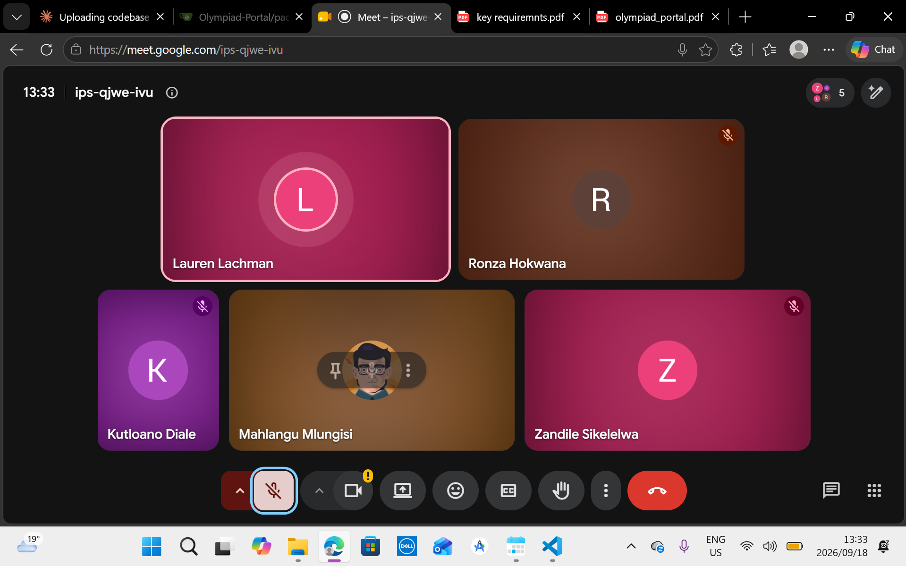

# Sprint 3 Planning — Team & Stakeholder Meeting

**Project:** Olympiad Portal
**Meeting type:** Sprint planning — team and stakeholder
**Date:** 18 September 2026
**Time:** 13:30 - 14:00
**Location:** Google Meet
**Attendees:**
- Zandile 
- Kutloano
- Ronie
- Mlungisi
- Lauren (Stakeholder)

**Proof of stakeholder interaction:** See attached screenshot:

---

## 1. Purpose of the meeting

To walk the stakeholder through Sprint 2's delivered features, present the Sprint 3 plan, and review the Sprint 3 rubric together so expectations are aligned before work starts.

## 2. Sprint 2 recap (presented to stakeholder)

- [Brief summary of what shipped in Sprint 2 — round lifecycle, auth, submissions, marking, notifications, standings, etc.]

## 3. Sprint 3 requirements and rubric — reviewed together

The team walked the stakeholder through the official Sprint 3 rubric, criterion by criterion, and discussed what "Advanced" looks like for each:

| Criterion | Weight | Advanced (target) |
|---|---|---|
| User Feedback | 10% | Extensive user testing and feedback gathering |
| Automated Testing | 10% | Extensive automated testing across all code bases (>60% coverage) |
| Feature Implementation | 20% | Most/all features implemented with minimal or non-severe bugs |
| API Implementation | 20% | All endpoints implemented, mostly bug free |
| Performance | 5% | No performance issues |
| Improvement | 5% | Extensive evidence of integrating user and stakeholder feedback |
| Documentation | 15% | All aspects of the project well documented |
| Project Methodology | 15% | Evidence of strictly following methodology |

## 4. Sprint 3 scope presented to stakeholder

The team presented the planned Advanced-tier feature scope for this sprint:

1. Co-organiser access for olympiads (multiple organisers per olympiad)
2. Multi-olympiad support with per-olympiad timezone handling
3. Audit log and round replay
4. Concurrency and boundary correctness for round open/close and submissions
5. Appeals and reviewer workflow for marks, feeding into standings

**Stakeholder feedback on scope:**
- Ensure all basic and intermediate features are completed.
- Ensure user feedback is collected, documented and incoporated into the platform.
- Ensure test coverage is above 60% and visible on the README.

## 5. Feedback about the Portal

- Try to check how data is fetched from the database to avoid fetching unnecessary data and improve speed.
- Increase the font on the main page to make it more readable.

---
*Minutes recorded by: Zandile Mkontwana*